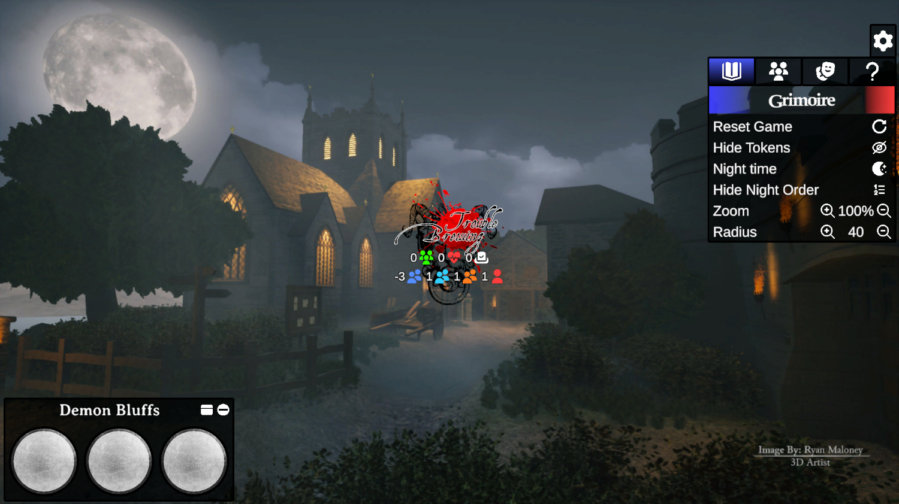
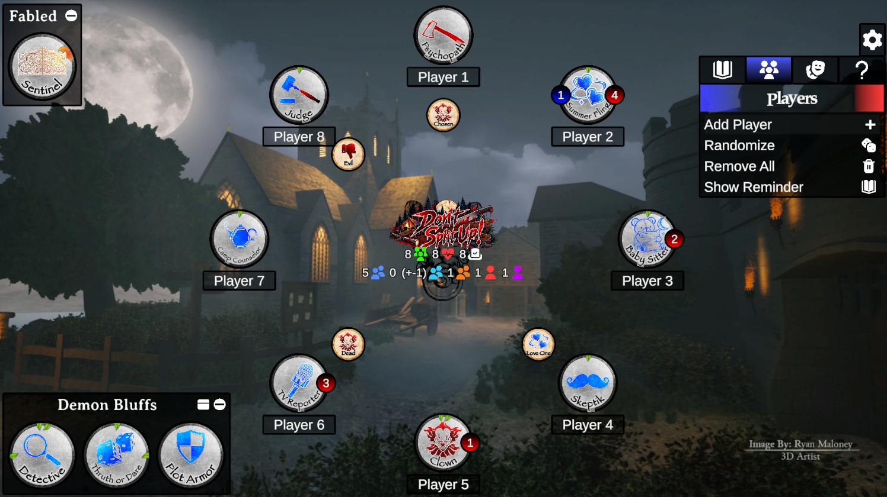
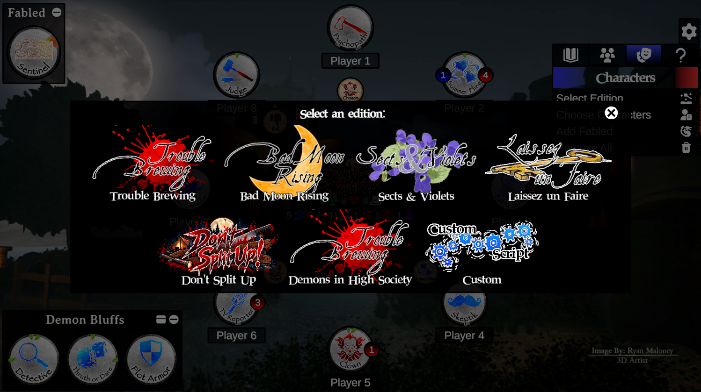
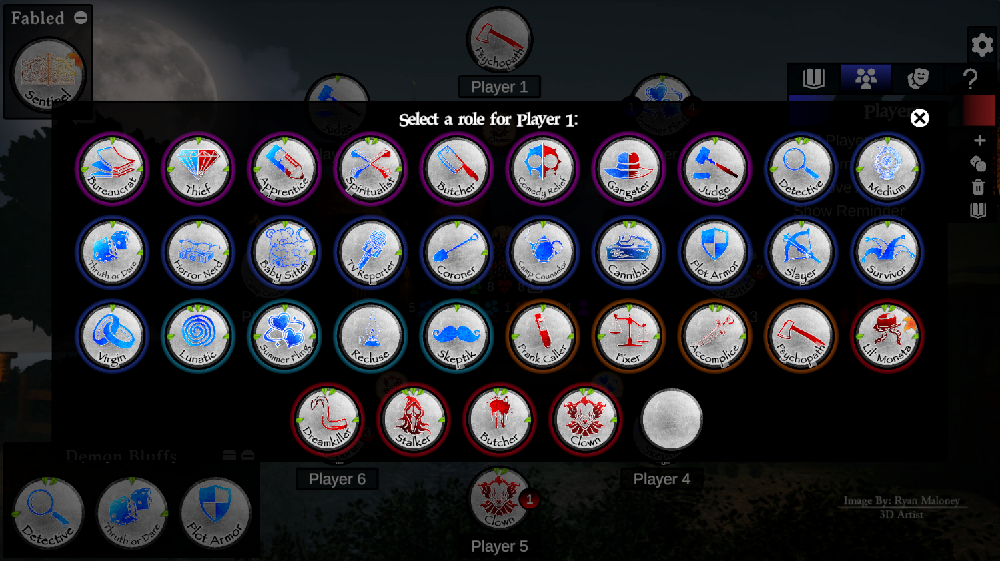
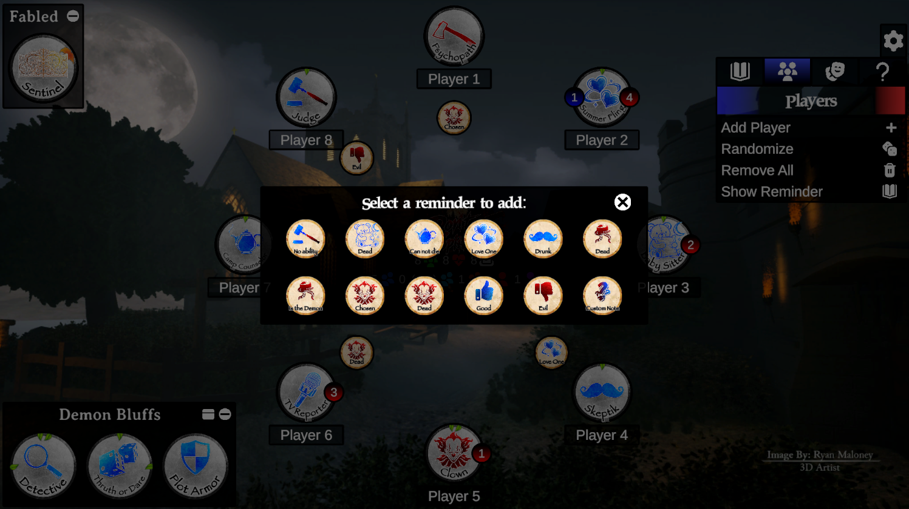
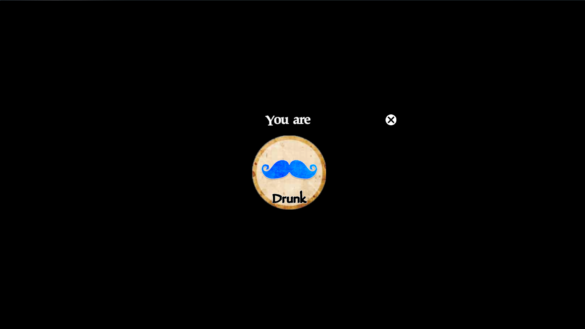
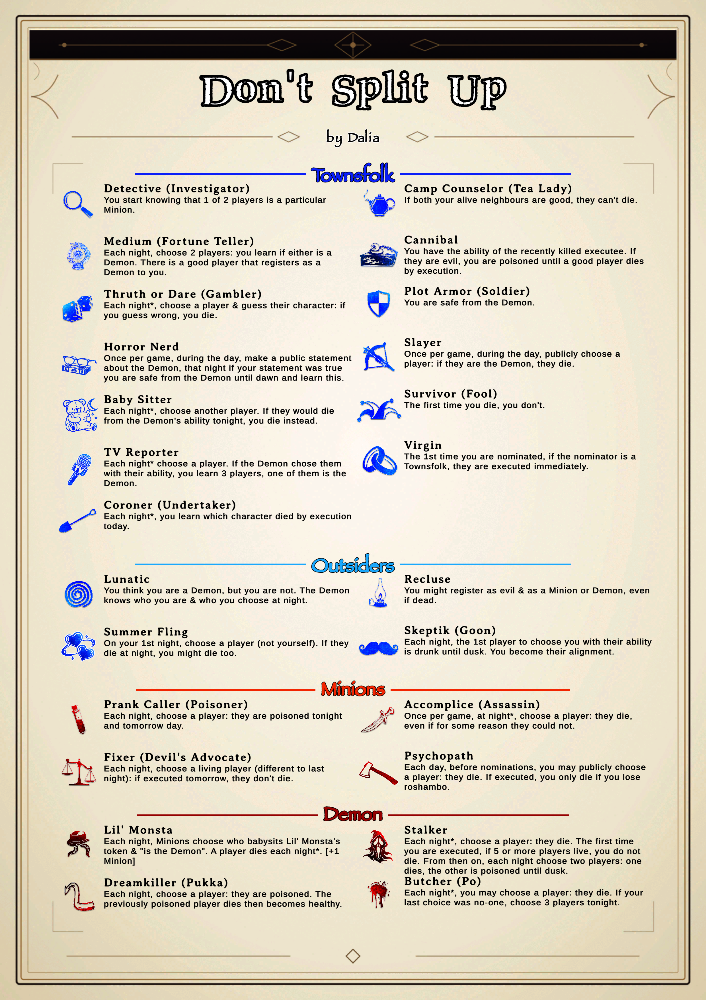
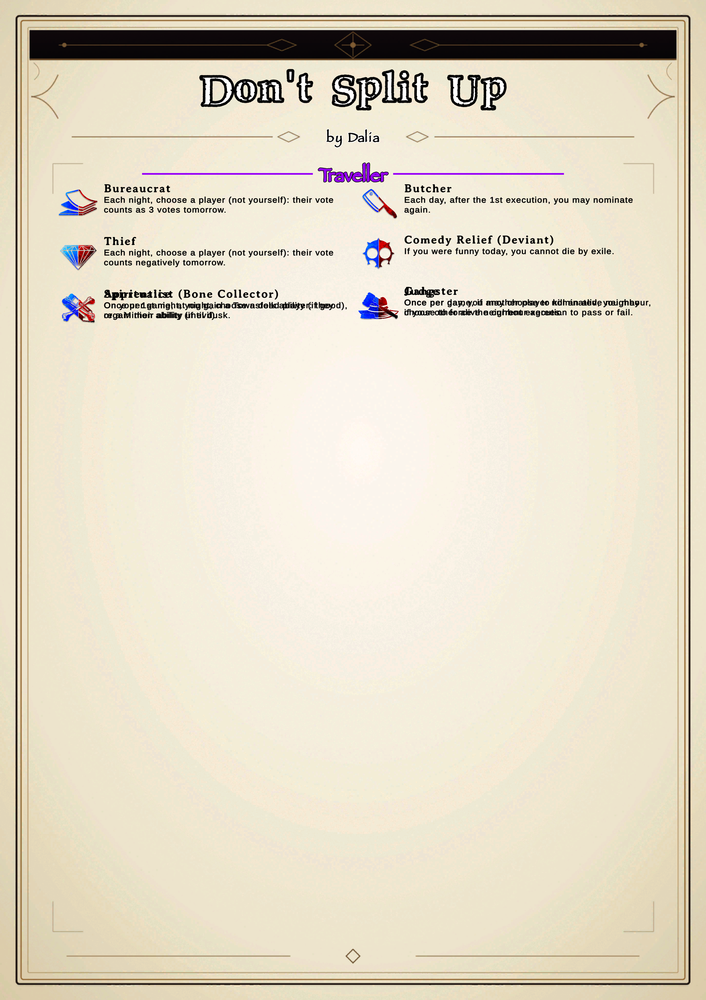

# BOTC_Game_Visualizer
A Unity 6000.4.0f1 UI system made to play the social deduction game Blood On The Clocktower, *by The Pandemonium Institute*.

## Description
This application is made to play the popular game BOTC without needing an internet connection, since the other available resource I could find is a web page.
This is not an official app for the game and I do not claim any rights to the IP, this is just a personal project made to play with my friends and as professional portfolio.

## Utilities
* Complete Story Teller control over the experience.
* Infinite player capacity (although not adjusted for legibility with an extreme number of players), with automatic calculations and reminders for team counts.
* Game state saved for every action, so closing is not losing progress.
* Complete game reset, for new games entirely, or just characters and reminders reset, for a different game in the same group.
* All official and some homebrew scripts, with functionality to upload custom scripts.
* Unrecognized characters and reminders handling, to play even with homebrew characters.

## Technical implementations
* Custom UI elements for automatic adjustment
  * Row/VBox
  * Column/HBox
  * Size adjust to children
  * Alignment
  * And some more.
* Event subscriptions to reduce coupling inside class hierarchies.
  * Game Manager that creates and initializes everything to ensure a deterministic start, and then catches relevant events to make the game flow.
  * Game hierarchy with initialization and function calling strictly down, and even invocation and catching to move the flow up.
* Character sheet download as 4K png.

